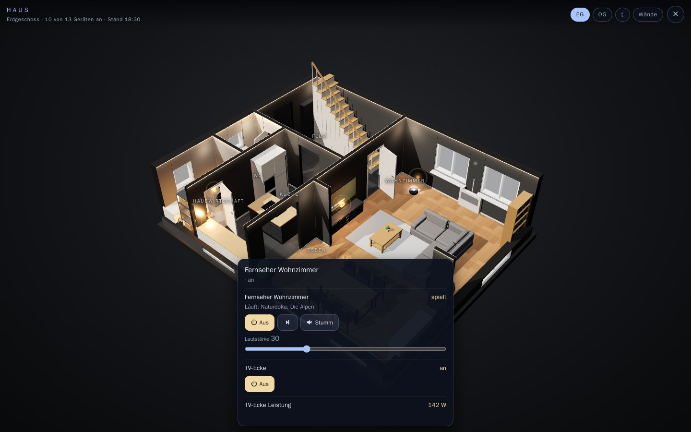
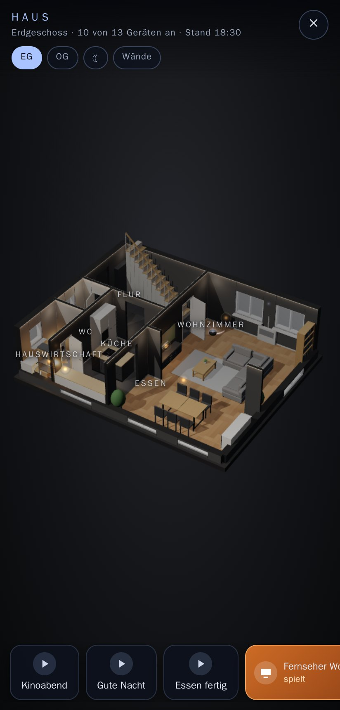
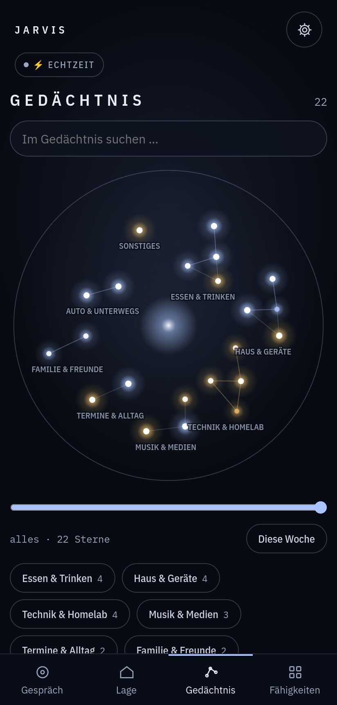
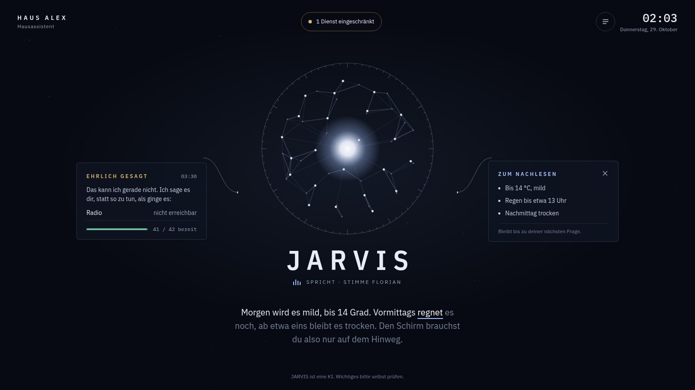
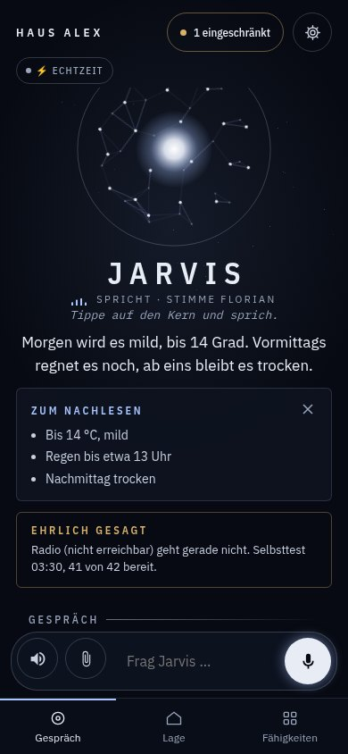
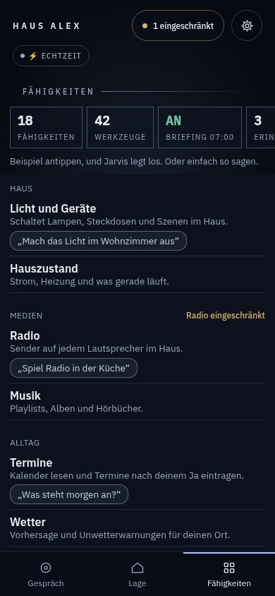
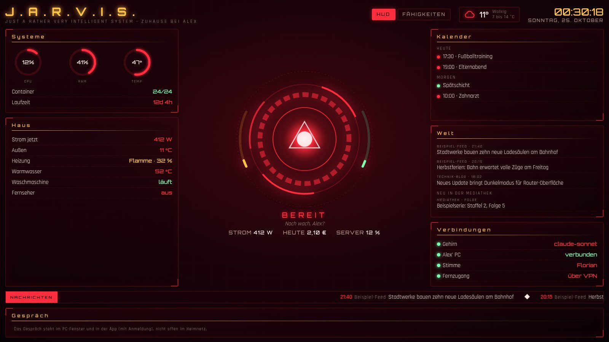
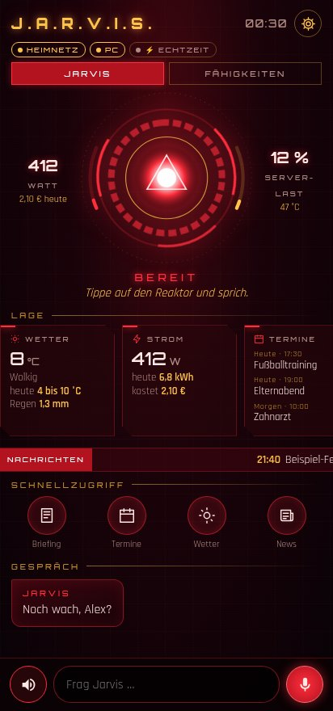
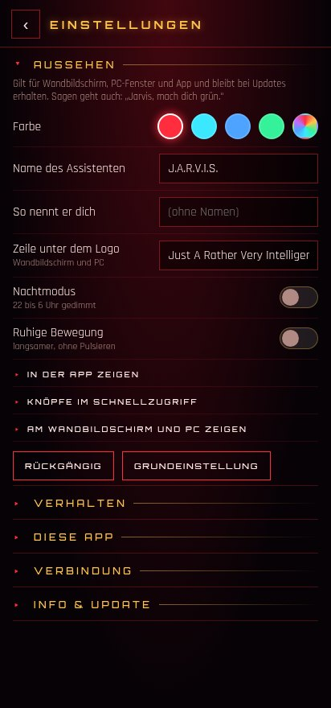
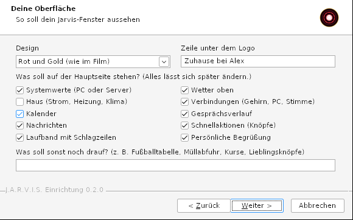

# J.A.R.V.I.S. – your home assistant, built by Claude Code

> **Requires Claude.** A Claude subscription (Pro or Max) or an API key from the Claude Console. Claude is Jarvis's
> brain, and it builds Jarvis for you, too.
>
> **Optional: Gemini.** Your own Gemini API key from Google for real-time mode (talk freely and interrupt at any
> time). Without it, only that mode is missing.

Deutsche Fassung: [README.md](README.md)

Jarvis is a home assistant with its own voice and personality, inspired by the AI butler from the Iron Man films.
It knows your calendar, your home and the world, remembers what you tell it, and only does what you allow.
Since 0.6 it shows your home as a 3D model where you tap devices to switch them, recognises at the speakers who is
talking, and does things on your phone when you ask.

This is **not a finished program**. It is a build guide that **Claude Code** follows to build your own Jarvis.
Every home is different (computers, smart home, calendars, wishes), so Claude asks, proposes, builds and tests each
stage before moving on. A Windows Setup.exe gets you started.

**Language:** Jarvis talks German or English, chosen in the setup. The setup, the app, the web app, the wall display
and PC window, and the Linux installer come in German and English; the app follows the phone's language and can be
switched in the gear menu. The build guide for Claude is [EINRICHTUNG.en.md](EINRICHTUNG.en.md) (English) or
[EINRICHTUNG.md](EINRICHTUNG.md) (German).

A private fan project. Not affiliated with Marvel, Disney, Anthropic or Google.



<p>
  
  
</p>

## New in 0.6

- **Your home in 3D.** Claude builds a model from your description, with rooms, doors, windows, stairs and
  furniture. Rotate and zoom, tap a device and switch it. TVs and the projector screen show what is playing, lamps
  glow. In the PC window, on the wall display, in the app and the web app.
- **It recognises who is speaking.** Three short sentences in the app, and Jarvis knows at the speakers who is
  asking. The voice can only lower permissions, never raise them, and it is not a password. Voice profiles stay on
  your own computer, and nobody is enrolled without their consent.
- **It works your phone.** "Open Spotify", "Set an alarm for 6:30" or "Torch on" happen right away. Calls and
  WhatsApp are prepared as a card and only go out after your spoken yes; a text message is left as a draft. Banking,
  password and mail apps are never operated.
- **Your memory as a constellation.** Every star is something Jarvis remembers, brighter the more often it is used.
  Tap, edit, or let it forget.
- **It follows up and passes things on.** It brings up open plans once, casually. "Tell Mia, when she gets home,
  that dinner is in the oven" is delivered as soon as her phone is back on the Wi-Fi. Guests get time-limited access
  with their own rules and, if you like, the QR code for the guest Wi-Fi.
- **Announcements in the right room** and, if you want, **a phone call**: a wake-up call, severe weather or a
  critical disk fault, with fixed rules for quiet hours and frequency.
- **TV, projector screen and family quiz**, if you have the devices: TV and apps by voice, recipe and shopping list on
  the projector, a quiz with a host voice for the whole family.
- **Protection against untrusted text.** Once Jarvis has read an email, a web page or a document in a question, it
  switches nothing and sends nothing in that same question, it asks you instead.
- Plus app 4.14, PC client 22 and a template with tests for every new building block. Details are in the
  [CHANGELOG](CHANGELOG.md).

**"Observatory" design** (since 0.5, choose it in the setup, by voice or in the gear menu):



<p>
  
  
</p>

**"Reactor" design** (default) and the app's gear menu:



<p>
  
  
</p>



All images show made-up sample data.

## Why this Jarvis

- **Two brains, each doing what it does best.** In real-time mode Gemini Live talks to you and you can interrupt at
  any time. For anything that needs knowledge or tools it asks Claude, the house brain with its tools (calendar,
  home, lists, news, PC).
- **One assistant, many ways in:** "Hey Jarvis" on your PC (Windows and Linux) with its own window, an Android
  app, a web app for the iPhone, Home Assistant, announcements on speakers, push messages to the family. Hand
  it photos, PDFs, documents and voice messages with the paperclip, take a photo right away on the phone, or drag them
  into the PC window. You get files back: PDFs from text, dictation or photos, edited and new images, converted
  files. You choose the services for that in the setup.
- **Your Jarvis, not mine.** The setup asks about you, the personality, what it should do and your interface
  (colors, panels, greeting, your own buttons). Claude only builds what you want.
- **Says honestly what isn't working** (since 0.5): in the new "Observatory" design a calm core replaces the
  reactor, the answer runs along as subtitles, facts stay as "To read back". If a service fails, Jarvis says so
  first ("Honestly: …") and shows what is limited right now. The reactor design stays selectable. Since 0.5.1 the
  Observatory has a "Status" tab with appointments, computer, containers, backups and PC.
- **Changes its appearance on request:** "Jarvis, turn green", "show me blue", "hide the ticker", "undo that". On the
  PC, the wall display and in the app, without reloading. Updates never overwrite your settings.
- **Grows with you:** say what you are planning, e.g. "keep an eye on my finances". Claude looks for suitable tools,
  checks maintenance, permissions and data flow, and proposes them. Nothing is installed without your OK.
- **For the whole family** (since 0.4): every phone can belong to a person, with their own memory, history and
  permissions. What someone tells Jarvis stays with that person. If you want, he learns from the conversations at
  night, never passwords, health or mail contents.
- **Takes everyday work off your hands** (since 0.4): scenes ("Good night" switches several things at once), the
  mailbox (read, tidy up, tell you when something arrives, never delete), photograph letters and file them with their
  deadlines in Paperless, report updates for your homelab and install them when you say so.
- **German and self-hosted:** made for German households, with connections to services you may already run
  (Home Assistant, Nextcloud, Vikunja, Paperless, Mealie and more). Claude checks every integration before building
  it.
- **Security from the start:**
    - The everyday brain has no shell and no file access.
    - A deny list blocks devices inside the tool itself, not just by instruction.
    - Messages to other people are only sent after your clear yes.
    - Tests run in test mode, devices pair with one-time codes.
    - Secrets never go into the chat.
    - The setup downloads have pinned versions and checksums. Exceptions: Claude Code and Git come in their current
      version from their official sources, Windows-MCP via a fixed cut-off date.
- **From real life:** the guide comes from a Jarvis that has been running in a family home since October 2026, and
  a complete test run on a fresh Windows laptop checked it.

## Honest positioning

- Looking for a mature all-round assistant with apps for every platform and a large community? **OpenClaw** or
  **Hermes Agent** are much further along.
- Everything must run without the cloud? **Home Assistant Assist** with local models is the better choice. Jarvis
  thinks with Claude in the cloud.
- This Jarvis is a small project with a clear niche: a German family home assistant you build yourself, Gemini as
  the voice, Claude as the brain.

## What you need

- **Windows 10 (version 1809) or later** for the Setup.exe. Without the setup, macOS or Linux work too.
- **Claude:** a subscription (Pro or Max) or a Claude Console account with an API key. Claude Code does not run on
  the free plan.
    - Subscription: no extra cost, but Jarvis shares your usage limits.
    - API: pay as you go. In our measurements, under one cent per question on average. The first question of a
      conversation costs a few cents. Set a monthly limit in the Console.
- **Gemini (optional):** your own API key from Google AI Studio, only for real-time mode.
- **Optional:** an always-on machine (NAS, mini PC, Raspberry Pi 5), Home Assistant, an Android phone.
- **Time:** the first complete test run took about six hours. About an hour and a half of it needed the person
  (questions, voice samples, phone, sign-ins). Claude builds and tests the rest on its own.

## Terms you should know

Read in October 2026. The current version at each provider is what counts.

- **Anthropic** ([Consumer Terms](https://www.anthropic.com/legal/consumer-terms)): 18 or older. You may not make
  your account available to anyone else. If others in your household talk to Jarvis, use an API key for their
  questions.
- **Google** ([Gemini API Additional Terms](https://ai.google.dev/gemini-api/terms)):
    - According to Google, the Gemini API is for developers building for professional or business purposes, not for
      consumer use. Decide for yourself whether that fits you.
    - 18 or older, and not in applications directed at or likely to be used by people under 18. So **never enable
      real-time mode on children's devices**.
    - If you make Jarvis available to others in the EEA, Switzerland or the UK, you may only use the paid services
      there.
    - In the EEA, Switzerland and the UK the paid-service data rules apply to the free quota as well. Elsewhere,
      Google may use free-quota input to improve its products.
- **Messages to others:** Jarvis marks messages it sends on your behalf as sent by an AI.
- **Speaker recognition (since 0.6, optional):** voice profiles are biometric data (GDPR Art. 9). Nobody is
  enrolled without their explicit consent, for children their parents' consent. The profiles stay on your own
  computer. The voice only lowers permissions and is not a password; without speaker recognition,
  permissions apply per device and access path.
- **Phone control (since 0.6, optional):** when Jarvis operates your phone through the accessibility
  service, the screen content goes to Claude. Blocked apps (banking, passwords, mail, messaging) are never
  operated.

## Setting it up

### With the Setup.exe (Windows)

1. Download `Jarvis-Setup.exe` from the releases and compare its checksum with the one in the release notes:
   `Get-FileHash .\Jarvis-Setup.exe` in PowerShell.
2. Run it. The file is not signed, so Windows warns once: "More info", then "Run anyway".
3. **Set up a new Jarvis:** the setup asks a few things first (you, personality, skills, plans, devices,
   interface), installs Claude Code with Anthropic's official installer and opens it in `%USERPROFILE%\Jarvis`. Sign
   in once in the browser, and Claude guides you through the rest.
4. **Connect to an existing Jarvis:** enter its address and a pairing code. The setup installs the Jarvis window
   with wake word, and optionally PC control, autostart and a desktop icon.

Uninstall via Windows Settings → Apps → "J.A.R.V.I.S.". Claude Code, uv and Git stay, because they may serve other
purposes. `installer/reste-pruefen.ps1` lists what is left and changes nothing.

When connecting, you choose the folder for the Jarvis client yourself (default `%LOCALAPPDATA%\Jarvis`). It must be
empty or new; the setup restricts its permissions to your account, and uninstalling deletes it completely only if
the setup created it.

### Linux

Download `Jarvis-Linux.tar.gz` from the releases, compare the checksum (`sha256sum Jarvis-Linux.tar.gz`), then:

```sh
tar xzf Jarvis-Linux.tar.gz && cd jarvis-linux
./installieren.sh               # connect to an existing Jarvis
./installieren.sh --neu         # set up a new Jarvis with Claude Code (project folder ~/Jarvis)
./installieren.sh --entfernen   # remove again
```

- Runs without root under `~/.local/share/jarvis` with its own Python environment. If libraries for sound or the
  window (PortAudio, Qt) are missing, the script names the packages and installs them with `sudo` after asking
  (apt, dnf or pacman).
- With a screen: Jarvis window, autostart and an entry in the application menu. Without a screen, for example on a
  Raspberry Pi with microphone and speaker: wake word and voice only, as a user service
  (`systemctl --user status jarvis`).
- Tested: Ubuntu 24.04 (x86_64) in a fresh container with a virtual display. ARM (aarch64) has its own package list,
  not yet tested on real hardware.
- PC control (opening programs, using windows) is Windows only.

### Android app

Install `Jarvis-App.apk` from the releases (Android 8 or newer; allow "install from this source" once). Pair via
pairing link or with address and pairing code. The app offers updates itself (gear → Info & Update) and checks the
checksum. The gear menu also holds appearance, behavior and the buttons. App sources are in `app/`.

### iPhone and iPad

There is no native iPhone app: without the App Store, Apple only allows installing via a Mac with Xcode (expires
after seven days) or a developer account. Instead, the bridge serves a **web app** that looks just like the Android
app:

1. On your home network, open `http://<Jarvis host>:<port>/app` in Safari.
2. Share → "Add to Home Screen".
3. Open Jarvis from the new icon and enter the pairing code **there**. Safari does not hand its storage to the icon,
   so pairing in the Safari tab would be lost.

Speak via the microphone on the iPhone keyboard; Jarvis answers with text and voice. Real-time mode, access from
outside and PC control are not available in the web app: it is served over HTTP, so its device only works on the
home network (background in [SECURITY.en.md](SECURITY.en.md)). Tested with Chromium at iPhone size, not yet on a
real iPhone.

### Mac

There is no native Mac client yet. It would be technically possible, but we have no Mac to test it on and don't
release anything untested. Until then, the **web app** works on a Mac too: on your home network, open
`http://<Jarvis host>:<port>/app` in Safari (or Chrome), pair in the tab, and speak into the input field with macOS
dictation. Wake word, real-time mode and PC control are missing there, as on the iPhone. If you have a Mac and want to
test, you're welcome (see [CONTRIBUTING.en.md](CONTRIBUTING.en.md)).

### By hand (any OS)

1. Install Claude Code: <https://code.claude.com/docs/en/setup>
2. Create an empty folder, put `EINRICHTUNG.en.md` in it, run `claude` there.
3. Type: `Read EINRICHTUNG.en.md and guide me through the setup.`

## Where data goes

- Memory, conversation history, profile and settings stay on your computer.
- Every question goes to Claude (Anthropic) with the context it needs, including data Jarvis looks up for it, such
  as appointments. For sensitive areas like banking Claude tells you first, and you decide.
- The `edge-tts` voice sends the answer text to Microsoft Edge's read-aloud service. The fallback voice Piper stays
  local.
- Real-time mode (if chosen) sends audio, instructions and answers to Google.
- Files you attach: images, PDF and text go to Claude with the question. The Jarvis host transcribes audio
  itself, only the transcript goes to Claude.
- Editing and creating images (if chosen): the image and the request go to the chosen provider (Cloudflare,
  OpenAI or Google). PDFs are made on the Jarvis host, conversion runs through your own Transmute.
- Speaking: on the PC, the Jarvis host recognizes speech itself. The Android app uses the phone's speech
  recognition (usually Google, depending on the device); on the iPhone the keyboard dictates (Apple).
- Web search, weather, news and the other skills query their respective services.
- HUD, app and web app load fonts from Google Fonts; Google sees the device's address.
- The PC client's log (`jarvis.log`) contains recognized sentences. It stays on the PC and is capped at 3 × 1 MB.
- Claude never asks for secrets (tokens, keys) in the chat. You put them in a file yourself.

## Security

What Jarvis never does: [NEVER.en.md](NEVER.en.md). How Jarvis is built, its limits and how to report a vulnerability: [SECURITY.en.md](SECURITY.en.md).

## Contents

| Path | What |
|---|---|
| `EINRICHTUNG.md` | the build guide for Claude Code: question rounds, build plan, security rules, acceptance test (English: `EINRICHTUNG.en.md`) |
| `installer/` | sources of the Setup.exe (NSIS) and the PowerShell scripts it runs |
| `linux/` | installer for Linux (`installieren.sh`) and the build script for `Jarvis-Linux.tar.gz` |
| `app/` | sources of the Android app and its build script (with its own signing key) |
| `vorlagen/pc/` | the PC client for Windows and Linux (wake word, Jarvis window, voice) and its packages with checksums |
| `vorlagen/hud/` | the interface, the same for everyone. Its settings come from the bridge |
| `vorlagen/bruecke/` | ready-made building blocks of the bridge with unit tests: appearance and behavior (`oberflaeche.py`, `verhalten.py`), files (`anhang.py`, `ausgabe.py`, `pdf.py`, `bilddienst.py`, `konvertieren.py`, `zusatzdienste.py`), update signature (`ed25519.py`), since 0.4 people, memory, scenes, mailbox and letters (`personen.py`, `gedaechtnis.py`, `szenen.py`, `postfach.py`, `briefe.py`), since 0.6 the 3D house, speaker recognition, phone control, untrusted-text lock, follow-ups, arrival, guests, rooms, calls, projector screen, quiz, update centre and disk health (`grundriss.py`, `sprecher.py`, `handy.py`, `fremdtext.py`, `faeden.py`, `ankunft.py`, `gaeste.py`, `raeume.py`, `anruf.py`, `leinwand.py`, `quiz.py`, `updates.py`, `nas_gesundheit.py`) |
| `vorlagen/webapp/` | web app for iPhone and browser: layer `jarvis-web.js` and build script (interface from `app/`) |
| `vorlagen/grundriss/` | since 0.6: the 3D house view (`haus3d.js` with `three.min.js`), a made-up sample house with its generator and a preview page |
| `vorlagen/gemeinsam/` | since 0.6: memory as a constellation (`sternbild.js`, `sternbild.css`) for the window, the app and the web app |
| `vorlagen/sprecher/` | since 0.6: the speaker recognition service (`jarvis_sprecher.py`) |
| `pakete_aufloesen.sh` | re-pins the client's packages (Windows and Linux, Python 3.12, with checksums) |

### Build the Setup.exe yourself

Linux or macOS with Docker:

```sh
installer/bauen.sh 0.3.1     # -> installer/dist/Jarvis-Setup.exe
```

On its first run, `bauen.sh` builds a small image with `makensis` (Debian, package `nsis`). Warnings count as errors.

## Third-party components

Setup, Linux package and app ship their own files, plus three.js for the 3D view (its licence text is included).
Everything else is downloaded from its source during setup:

- **openWakeWord** (wake word): code under Apache 2.0. The "Hey Jarvis" model and the related models are licensed
  **CC BY-NC-SA 4.0**, noncommercial use only.
- **uv** (Astral), **Windows-MCP**, **pywebview**, **sounddevice**, **wyoming**, **onnxruntime** and other Python
  packages: each under its own license, listed in `vorlagen/pc/pakete.txt`.
- **Claude Code** by Anthropic, via its official installer and under its terms.
- **three.js** (3D house view, included): MIT licence, see `vorlagen/grundriss/three.LICENSE.txt`.
- **sherpa-onnx** (speaker recognition): Apache 2.0. The ERes2Net speaker model comes from **3D-Speaker**
  (Apache 2.0) and is downloaded during setup, not shipped.

## License

**[PolyForm Noncommercial License 1.0.0](LICENSE).** In short (the license text is what counts):

- **Allowed** for personal and other noncommercial purposes: use, change, extend and share. When you share, include
  the license text and the `Required Notice: …` line.
- **Not allowed** without written permission: commercial use, such as selling Jarvis or parts of it, building it into a
  paid product or offering it as a paid service.
- This is source-available, not an open source license by the OSI definition.

Contributions are very welcome: [CONTRIBUTING.en.md](CONTRIBUTING.en.md). Changes: [CHANGELOG.md](CHANGELOG.md) (German).
