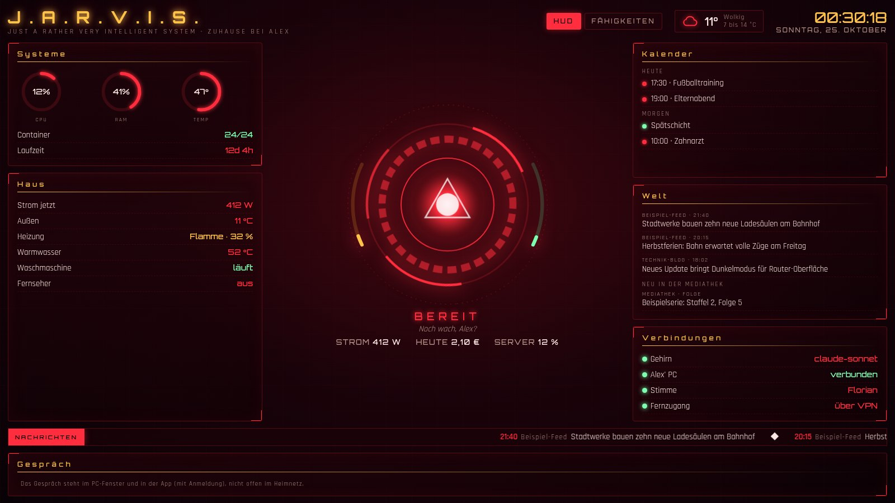
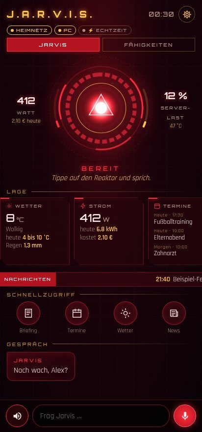
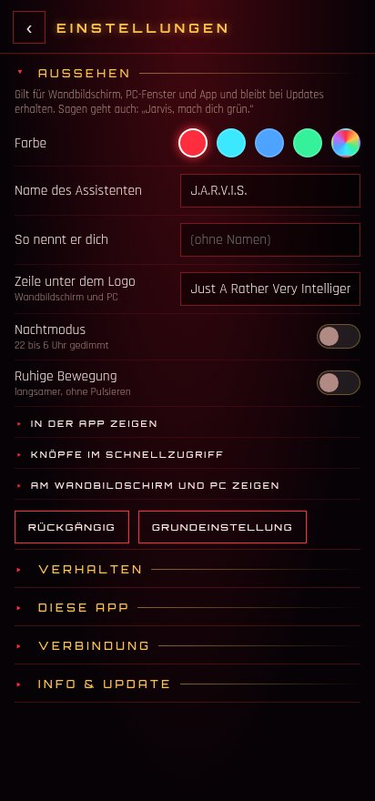
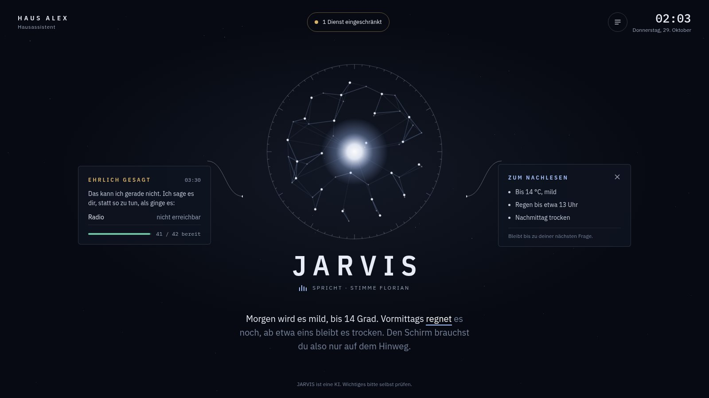
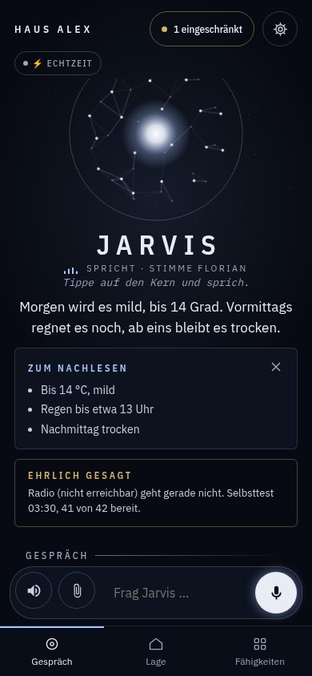
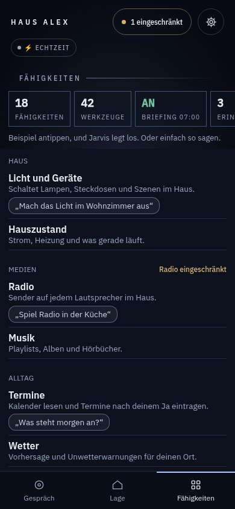
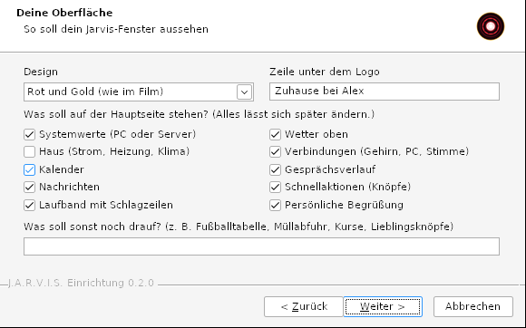

# J.A.R.V.I.S. – dein Hausassistent, gebaut von Claude Code

> **Voraussetzung: Claude.** Ein Claude-Abo (Pro oder Max) oder ein API-Schlüssel aus der Claude Console. Claude
> ist das Gehirn von Jarvis und baut ihn dir auch.
>
> **Optional: Gemini.** Ein eigener Gemini-API-Schlüssel von Google für den Echtzeit-Modus (fließend reden und
> dazwischenreden). Ohne ihn fehlt nur dieser Modus.

English version: [README.en.md](README.en.md)

**Sprachen:** Jarvis spricht Deutsch oder Englisch (Wahl im Setup). Setup, App, Web-App, Wandbildschirm und
PC-Fenster sowie der Linux-Installer gibt es auf Deutsch und Englisch; die App folgt der Sprache des Handys und lässt
sich im Zahnrad umstellen. Bauanleitung für Claude: [EINRICHTUNG.md](EINRICHTUNG.md) (Deutsch) bzw.
[EINRICHTUNG.en.md](EINRICHTUNG.en.md) (Englisch).

Jarvis ist ein Hausassistent mit eigener Stimme und Persönlichkeit, inspiriert vom KI-Butler aus den Iron-Man-Filmen.
Er kennt deinen Kalender, dein Zuhause und die Welt, merkt sich, was du ihm sagst, und tut nur, was du erlaubst.

Das hier ist **kein fertiges Programm**, sondern eine Bauanleitung, nach der **Claude Code** dir deinen eigenen
Jarvis baut. Jede Umgebung ist anders: Rechner, Smart Home, Kalender, Wünsche. Claude fragt nach, schlägt vor, baut
und prüft jede Stufe, bevor es weitergeht. Eine Setup.exe für Windows nimmt dir den Anfang ab.

Ein privates Fanprojekt. Nicht verbunden mit Marvel, Disney, Anthropic oder Google.



<p>
  
  
</p>

**Design „Observatorium“** (seit 0.5, im Setup, per Zuruf oder im Zahnrad wählbar):



<p>
  
  
</p>



Alle Bilder zeigen erfundene Beispieldaten.

## Warum dieser Jarvis

- **Zwei Gehirne, jedes für das, was es am besten kann.** Im Echtzeit-Modus spricht Gemini Live mit dir, du kannst
  jederzeit dazwischenreden. Für alles, was Wissen oder Werkzeuge braucht, fragt es Claude, das Hausgehirn mit
  seinen Werkzeugen (Kalender, Haus, Listen, Nachrichten, PC).
- **Ein Assistent, viele Wege:** „Hey Jarvis“ am PC (Windows und Linux) mit eigenem Fenster, eine Android-App, eine
  Web-App fürs iPhone, Home Assistant, Durchsagen auf Lautsprechern, Push-Nachrichten an die Familie. Fotos,
  PDFs, Dokumente und Sprachnachrichten gibst du ihm per Büroklammer, am Handy auch direkt als Foto, oder ziehst sie
  ins PC-Fenster. Zurück bekommst du Dateien: PDFs aus Text, Diktat oder Fotos, veränderte und neue Bilder,
  umgewandelte Dateien. Welche Dienste er dafür nutzt, wählst du im Setup.
- **Dein Jarvis, nicht meiner.** Das Setup fragt nach dir, nach der Persönlichkeit, nach dem, was er können soll,
  und nach deiner Oberfläche: Farben, Bereiche, Begrüßung, eigene Knöpfe. Claude baut nur, was du willst.
- **Sagt ehrlich, was gerade nicht geht** (seit 0.5): Im neuen Design „Observatorium“ steht ein ruhiger Kern
  statt des Reaktors, die Antwort läuft als Untertitel mit, Fakten bleiben als „Zum Nachlesen“ stehen. Fällt ein
  Dienst aus, sagt Jarvis das zuerst („Ehrlich gesagt: …“) und zeigt, was gerade eingeschränkt ist. Das
  Reaktor-Design bleibt wählbar. Das Observatorium hat seit 0.5.1 einen Reiter „Lage“ mit Terminen, Rechner, Containern,
  Sicherungen und PC.
- **Er baut sein Aussehen auf Zuruf um:** „Jarvis, mach dich grün“, „Zeig mal, wie Blau aussieht“, „Blende das
  Laufband aus“, „Mach das rückgängig“. Am PC, auf dem Bildschirm und in der App, ohne Neuladen. Updates
  überschreiben deine Einstellungen nicht.
- **Wächst mit:** Du sagst, was du vorhast, etwa „Finanzen im Blick behalten“. Claude sucht passende Werkzeuge,
  prüft sie auf Pflege, Rechte und Datenfluss und schlägt sie dir vor. Installiert wird nur, was du bestätigst.
- **Für die ganze Familie** (seit 0.4): Jedes Handy kann einer Person gehören, mit eigenem Gedächtnis, eigenem
  Verlauf und eigenen Rechten. Was jemand Jarvis erzählt, bleibt bei dieser Person. Auf Wunsch lernt er nachts aus
  den Gesprächen mit, nie Kennwörter, Gesundheit oder Mailinhalte.
- **Nimmt Alltagsarbeit ab** (seit 0.4): Szenen („Gute Nacht“ schaltet mehrere Dinge auf einmal), das Postfach
  (lesen, aufräumen, Bescheid sagen, nie löschen), Briefe abfotografieren und mit ihren Fristen in Paperless
  ablegen, Updates fürs Homelab melden und auf Zuruf einspielen.
- **Deutsch und selbst gehostet:** gemacht für deutsche Haushalte, mit Anbindung an Dienste, die du vielleicht
  schon betreibst (Home Assistant, Nextcloud, Vikunja, Paperless, Mealie und mehr). Claude prüft jede Anbindung,
  bevor es sie baut.
- **Sicherheit von Anfang an:**
    - Das Gehirn für Alltagsfragen hat keine Shell und keinen Dateizugriff.
    - Eine Tabu-Liste sperrt Geräte im Werkzeug selbst, nicht nur per Anweisung.
    - Senden an andere geht nur nach deinem klaren Ja.
    - Proben laufen im Testmodus, Geräte koppeln per Einmal-Code.
    - Geheimnisse gehören nie in den Chat.
    - Die Downloads des Setups haben feste Versionen und Prüfsummen. Ausnahmen: Claude Code und Git kommen in der
      aktuellen Fassung von ihren offiziellen Quellen, Windows-MCP über einen festen Stichtag.
- **Aus dem Alltag:** Die Anleitung stammt aus einem Jarvis, der seit Oktober 2026 in einem Familienhaushalt
  läuft. Ein vollständiger Testlauf auf einem frischen Windows-Laptop hat sie geprüft.

## Ehrlich eingeordnet

- Suchst du einen ausgereiften Allround-Assistenten mit Apps für alle Plattformen und großer Gemeinschaft, sind
  **OpenClaw** oder **Hermes Agent** deutlich weiter.
- Soll alles ohne Cloud laufen, ist **Home Assistant Assist** mit lokalen Modellen die bessere Wahl. Jarvis denkt
  mit Claude in der Cloud.
- Dieser Jarvis ist ein kleines Projekt mit einer klaren Nische: ein deutscher Familien-Hausassistent zum
  Selbstbauen, Gemini als Stimme, Claude als Gehirn.

## Was du brauchst

- **Windows 10 (Version 1809) oder neuer** für die Setup.exe. Ohne Setup geht es auch unter macOS oder Linux.
- **Claude:** ein Abo (Pro oder Max) oder ein Konto in der Claude Console mit API-Schlüssel. Mit dem kostenlosen
  Plan läuft Claude Code nicht.
    - Abo: keine Zusatzkosten, aber Jarvis teilt sich die Nutzungsgrenzen mit dir.
    - API: Abrechnung nach Verbrauch, in unseren Messungen im Schnitt unter einem Cent je Frage. Die erste Frage
      eines Gesprächs kostet ein paar Cent. Eine Monatsgrenze setzt du in der Console.
- **Gemini (optional):** ein eigener API-Schlüssel aus Google AI Studio, nur für den Echtzeit-Modus.
- **Optional:** ein Rechner, der immer läuft (NAS, Mini-PC, Raspberry Pi 5), Home Assistant, ein Android-Handy.
- **Zeit:** Der erste vollständige Testlauf dauerte rund sechs Stunden. Davon warst du etwa anderthalb Stunden
  gefragt (Fragen, Hörproben, Handy, Anmeldungen), den Rest baut und prüft Claude allein.

## Bedingungen, die du kennen solltest

Gelesen im Oktober 2026. Maßgeblich ist die jeweils aktuelle Fassung beim Anbieter.

- **Anthropic** ([Verbraucherbedingungen](https://www.anthropic.com/legal/consumer-terms)): Nutzung ab 18. Das
  eigene Konto darf man niemandem zur Verfügung stellen. Reden noch andere im Haushalt mit Jarvis, nimm für ihre
  Fragen einen API-Schlüssel.
- **Google** ([Gemini API Additional Terms](https://ai.google.dev/gemini-api/terms)):
    - Die Gemini-API ist laut Google für Entwickler mit beruflichen oder geschäftlichen Zwecken gedacht, nicht für
      Verbraucher. Entscheide selbst, ob das für dich passt.
    - Nutzung ab 18, und nicht in Anwendungen, die sich an unter 18-Jährige richten oder voraussichtlich von ihnen
      genutzt werden. Den Echtzeit-Modus also **nie auf Geräten von Kindern**.
    - Wer Jarvis anderen im EWR, in der Schweiz oder in Großbritannien zur Verfügung stellt, darf dort nur die
      bezahlten Dienste nutzen.
    - Im EWR, in der Schweiz und in Großbritannien gelten die Datenregeln der bezahlten Dienste auch für das
      kostenlose Kontingent. Anderswo darf Google Eingaben im kostenlosen Kontingent zur Verbesserung nutzen.
- **Nachrichten an andere:** Jarvis kennzeichnet Nachrichten, die er in deinem Auftrag verschickt, als von einer KI
  verschickt.
- **Jarvis unterscheidet keine Stimmen.** Rechte gelten je Gerät und Zugang, nicht je Sprecher.

## Einrichten

### Mit der Setup.exe (Windows)

1. `Jarvis-Setup.exe` aus den Releases laden und die Prüfsumme mit der im Release-Text vergleichen:
   `Get-FileHash .\Jarvis-Setup.exe` in PowerShell.
2. Starten. Die Datei ist nicht signiert, Windows warnt deshalb einmal: „Weitere Informationen“, dann „Trotzdem
   ausführen“.
3. **Neuen Jarvis einrichten:**
    - Das Setup fragt ein paar Dinge vorab: dich, die Persönlichkeit, die Fähigkeiten, was du vorhast, deine
      Geräte und deine Oberfläche.
    - Dann installiert es Claude Code (offizieller Installer von Anthropic) und öffnet es im Ordner
      `%USERPROFILE%\Jarvis`.
    - Dort meldest du dich einmal im Browser an. Claude führt dich durch den Rest.
4. **Mit einem bestehenden Jarvis verbinden:** Adresse und Kopplungscode eingeben. Das Setup richtet das
   Jarvis-Fenster mit Weckwort ein, auf Wunsch auch PC-Steuerung, Autostart und Desktop-Symbol.

Aufräumen: Windows-Einstellungen → Apps → „J.A.R.V.I.S.“ deinstallieren. Claude Code, uv und Git bleiben, weil
sie auch für anderes da sein können. `installer/reste-pruefen.ps1` listet auf, was noch da ist, und ändert nichts.

Den Ordner für den Jarvis-Client wählst du beim Verbinden selbst (Vorgabe `%LOCALAPPDATA%\Jarvis`). Er muss leer
oder neu sein; das Setup setzt seine Rechte auf dein Konto, und die Deinstallation löscht ihn nur ganz, wenn das
Setup ihn angelegt hat.

### Linux

`Jarvis-Linux.tar.gz` aus den Releases laden, Prüfsumme vergleichen (`sha256sum Jarvis-Linux.tar.gz`), dann:

```sh
tar xzf Jarvis-Linux.tar.gz && cd jarvis-linux
./installieren.sh               # mit einem bestehenden Jarvis verbinden
./installieren.sh --neu         # neuen Jarvis mit Claude Code einrichten (Projektordner ~/Jarvis)
./installieren.sh --entfernen   # wieder entfernen
```

- Läuft ohne Root-Rechte unter `~/.local/share/jarvis`, mit eigener Python-Umgebung. Fehlen Bibliotheken für Ton
  oder Fenster (PortAudio, Qt), nennt das Skript die Pakete und installiert sie nach Rückfrage mit `sudo`
  (apt, dnf oder pacman).
- Mit Bildschirm: Jarvis-Fenster, Autostart und Eintrag im Anwendungsmenü. Ohne Bildschirm, etwa auf einem
  Raspberry Pi mit Mikrofon und Lautsprecher: nur Weckwort und Stimme, als Benutzerdienst
  (`systemctl --user status jarvis`).
- Getestet: Ubuntu 24.04 (x86_64) in einem frischen Container mit virtuellem Bildschirm. Für ARM (aarch64) gibt es
  eine eigene Paketliste, sie ist noch nicht auf echter Hardware geprüft.
- PC-Steuerung (Programme öffnen, Fenster bedienen) gibt es nur unter Windows.

### Android-App

`Jarvis-App.apk` aus den Releases installieren (Android 8 oder neuer; einmal „Aus dieser Quelle installieren“
erlauben). Koppeln per Kopplungslink oder mit Adresse und Kopplungscode. Updates bietet die App selbst an
(Zahnrad → Info & Update) und prüft dabei die Prüfsumme. Im Zahnrad stellst du auch Aussehen, Verhalten und
die Knöpfe ein. Die App-Quellen liegen unter `app/`.

### iPhone und iPad

Eine eigene iPhone-App gibt es nicht: Ohne App Store bleibt Apple nur die Installation über einen Mac mit Xcode, die
nach sieben Tagen abläuft, oder ein Entwicklerkonto. Stattdessen liefert die Brücke eine **Web-App**, die genauso
aussieht wie die Android-App:

1. Im Heimnetz in Safari `http://<Jarvis-Rechner>:<Port>/app` öffnen.
2. Teilen → „Zum Home-Bildschirm“.
3. Jarvis über das neue Symbol öffnen und **dort** den Kopplungscode eingeben. Safari gibt dem Symbol seinen
   Speicher nicht mit, eine Kopplung im Safari-Tab wäre dort weg.

Sprechen geht über das Mikrofon der iPhone-Tastatur, Jarvis antwortet mit Text und Stimme. Echtzeit-Modus, Zugriff
von unterwegs und PC-Steuerung gibt es in der Web-App nicht: Sie kommt per HTTP, deshalb gilt ihr Gerät nur im
Heimnetz (Hintergrund in [SECURITY.md](SECURITY.md)). Die Web-App ist mit Chromium im iPhone-Format getestet, noch
nicht auf einem echten iPhone.

### Mac

Einen eigenen Mac-Client gibt es noch nicht. Technisch ginge er, wir können ihn aber mangels Mac nicht testen und
veröffentlichen nichts Ungetestetes. Bis dahin läuft die **Web-App** auch am Mac: im Heimnetz in Safari (oder Chrome)
`http://<Jarvis-Rechner>:<Port>/app` öffnen, im Tab koppeln und über die Diktierfunktion von macOS ins Eingabefeld
sprechen. Weckwort, Echtzeit-Modus und PC-Steuerung fehlen dort, wie auf dem iPhone. Wer einen Mac hat und testen
möchte, ist willkommen (siehe [CONTRIBUTING.md](CONTRIBUTING.md)).

### Von Hand (jedes System)

1. Claude Code installieren: <https://code.claude.com/docs/en/setup>
2. Einen leeren Ordner anlegen, `EINRICHTUNG.md` hineinlegen, dort `claude` starten.
3. Schreiben: `Lies EINRICHTUNG.md und führe mich durch die Einrichtung.`

## Was wohin geht

- Gedächtnis, Gesprächsverlauf, Profil und Einstellungen bleiben auf deinem Rechner.
- Jede Frage geht mit dem nötigen Kontext an Claude (Anthropic). Das gilt auch für Daten, die Jarvis dafür
  nachschlägt, etwa Termine. Bei sensiblen Bereichen wie Banking weist Claude dich vorher darauf hin, und du
  entscheidest.
- Die Stimme über `edge-tts` schickt den Antworttext an den Vorlesedienst von Microsoft Edge. Die Reserve-Stimme
  Piper bleibt lokal.
- Echtzeit (falls gewählt) schickt Ton, Anweisung und Antworten an Google.
- Dateien, die du anhängst: Bilder, PDF und Text gehen mit der Frage an Claude. Ton schreibt der Jarvis-Rechner
  selbst ab, an Claude geht nur die Abschrift.
- Bilder bearbeiten und erzeugen (falls gewählt): Bild und Auftrag gehen an den gewählten Anbieter (Cloudflare,
  OpenAI oder Google). PDFs entstehen auf dem Jarvis-Rechner, Umwandeln läuft über dein eigenes Transmute.
- Sprechen: Am PC erkennt der Jarvis-Rechner die Sprache selbst. Die Android-App nutzt die Spracherkennung des
  Handys (je nach Gerät meist Google), am iPhone diktiert die Tastatur (Apple).
- Websuche, Wetter, Nachrichten und die übrigen Fähigkeiten fragen die jeweiligen Dienste ab.
- HUD, App und Web-App laden Schriften von Google Fonts; Google sieht dabei die Adresse des Geräts.
- Das Protokoll des PC-Clients (`jarvis.log`) enthält erkannte Sätze. Es bleibt auf dem PC und ist auf 3 × 1 MB
  begrenzt.
- Geheimnisse (Token, Schlüssel) fragt Claude nie im Chat ab. Du legst sie selbst in eine Datei.

## Sicherheit

Was Jarvis nie tut: [NEVER.md](NEVER.md). Wie Jarvis aufgebaut ist, wo die Grenzen liegen und wie du eine Lücke meldest: [SECURITY.md](SECURITY.md).

## Inhalt

| Pfad | Was |
|---|---|
| `EINRICHTUNG.md` | der Leitfaden für Claude Code: Fragerunden, Bauplan, Sicherheitsregeln, Abnahme (englisch: `EINRICHTUNG.en.md`) |
| `installer/` | Quellen der Setup.exe (NSIS, Texte in `texte.nsh`) und die PowerShell-Skripte, die sie ausführt |
| `linux/` | Installer für Linux (`installieren.sh`) und das Bauskript für `Jarvis-Linux.tar.gz` |
| `app/` | Quellen der Android-App und ihr Bauskript (mit eigenem Signaturschlüssel) |
| `vorlagen/pc/` | der PC-Client für Windows und Linux (Weckwort, Jarvis-Fenster, Stimme) und seine Pakete mit Prüfsummen |
| `vorlagen/hud/` | die Oberfläche, für alle gleich. Ihre Einstellungen kommen von der Brücke |
| `vorlagen/bruecke/` | fertige Bausteine der Brücke mit Einheitentests: Aussehen und Verhalten (`oberflaeche.py`, `verhalten.py`), Dateien (`anhang.py`, `ausgabe.py`, `pdf.py`, `bilddienst.py`, `konvertieren.py`, `zusatzdienste.py`), Update-Signatur (`ed25519.py`), seit 0.4 Personen, Gedächtnis, Szenen, Postfach und Briefe (`personen.py`, `gedaechtnis.py`, `szenen.py`, `postfach.py`, `briefe.py`) |
| `vorlagen/webapp/` | Web-App für iPhone und Browser: Schicht `jarvis-web.js` und Bauskript (Oberfläche aus `app/`) |
| `pakete_aufloesen.sh` | legt die Pakete des Clients neu fest (Windows und Linux, Python 3.12, mit Prüfsummen) |

### Setup.exe selbst bauen

Linux oder macOS mit Docker:

```sh
installer/bauen.sh 0.3.1     # -> installer/dist/Jarvis-Setup.exe
```

`bauen.sh` baut beim ersten Lauf ein kleines Bild mit `makensis` (Debian, Paket `nsis`). Warnungen gelten als Fehler.

## Fremde Bestandteile

Das Setup liefert nur eigene Dateien aus. Alles andere lädt es bei der Einrichtung von der Quelle:

- **openWakeWord** (Weckwort): Code unter Apache 2.0. Das Modell „Hey Jarvis“ und die zugehörigen Modelle stehen
  unter **CC BY-NC-SA 4.0**, also nur für nicht kommerzielle Nutzung.
- **uv** (Astral), **Windows-MCP**, **pywebview**, **sounddevice**, **wyoming**, **onnxruntime** und weitere
  Python-Pakete: jeweils ihre eigene Lizenz, die Liste steht in `vorlagen/pc/pakete.txt`.
- **Claude Code** von Anthropic, über dessen offiziellen Installer und unter dessen Bedingungen.

## Lizenz

**[PolyForm Noncommercial License 1.0.0](LICENSE).** Kurz gesagt (verbindlich ist der Lizenztext):

- **Erlaubt** für private und andere nicht-kommerzielle Zwecke: nutzen, ändern, erweitern und weitergeben. Wer
  weitergibt, gibt den Lizenztext und die Zeile `Required Notice: …` mit.
- **Nicht erlaubt** ohne schriftliche Erlaubnis: kommerzielle Nutzung, also etwa Jarvis oder Teile davon verkaufen,
  in ein bezahltes Produkt einbauen oder als bezahlte Dienstleistung anbieten.
- Das ist quelloffen im Sinne von „einsehbar und veränderbar“, aber keine Open-Source-Lizenz nach OSI-Definition.

Mitmachen ist ausdrücklich erwünscht: [CONTRIBUTING.md](CONTRIBUTING.md). Änderungen: [CHANGELOG.md](CHANGELOG.md).
